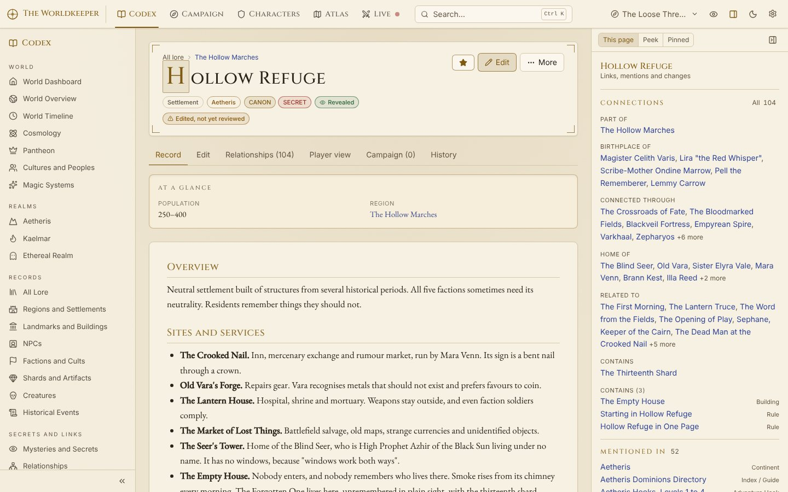
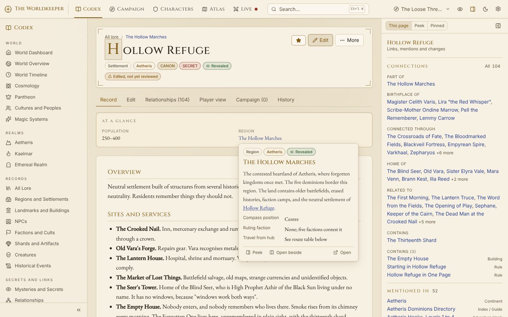
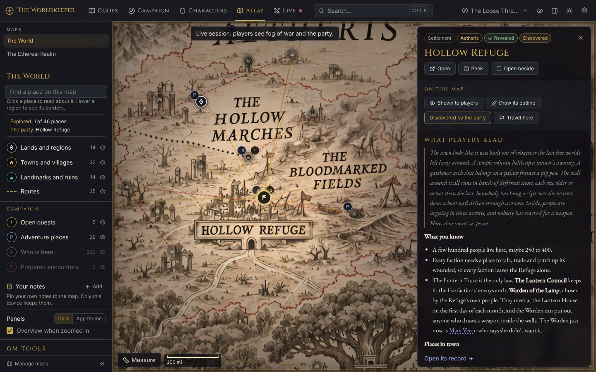
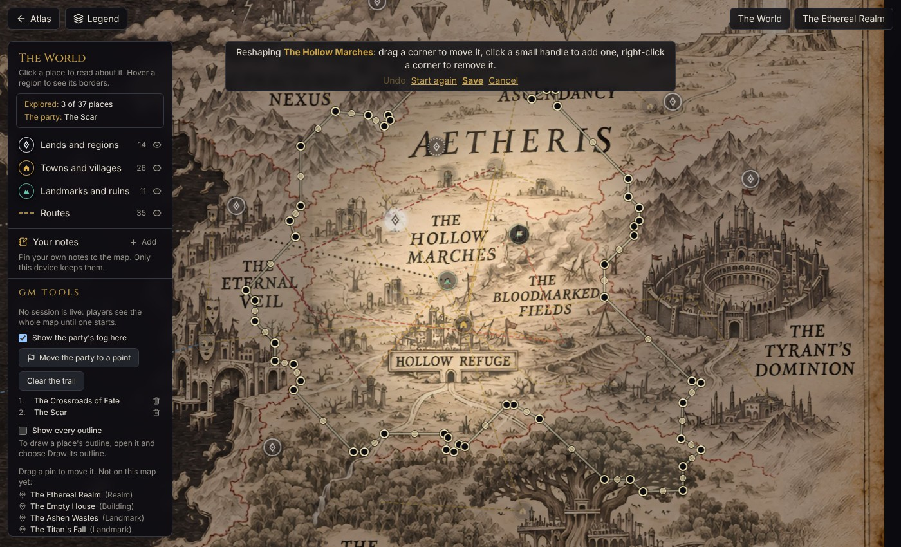
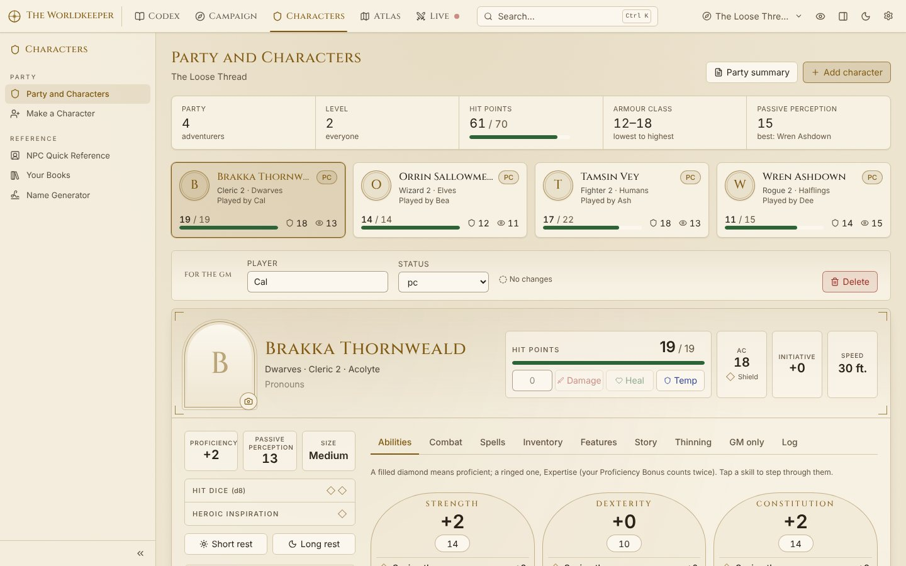

# The Worldkeeper

**Your world. Your canon. Your campaigns.**

The Worldkeeper is a **free, open-source, local-first worldbuilding encyclopedia and D&D 5e (2024) campaign manager**. Import existing Markdown lore, connect characters, factions and locations, explore maps, run sessions, and share only the knowledge your players have discovered.

Originally designed for a world with three branches, **Aetheris**, **Kaelmar**, and the **Ethereal Realm**, it preserves stable IDs, source references, canon labels and GM secrets while providing tools to manage independent campaigns. It can run a **standard D&D 2024 campaign**: switch the setting's mechanics off, import the books you own, and play. Full support for a world of your own (its own realms, calendar, templates and a first-run wizard) is planned; see [Your own world](docs/OWN_WORLD_PLAN.md).

**No account, required cloud service, paid API or AI dependency.** World data lives on your computer in SQLite and an uploads directory, with backups and portable exports.

> **Status:** v0.4 **“Illuminated”**, an early functional release with a complete redesign: one design for the GM app, the table server and the player handbook, in Warm Parchment or Dark Codex. Some features and desktop platform builds are still undergoing validation. Read [Development Status](DEVELOPMENT_STATUS.md) before relying on the application for important campaign data.

## Screenshots

Actual screenshots from Worldkeeper, with the Worldkeeper setting's world and a sample campaign, *The Loose Thread*.

### World dashboard

Your active campaign, what you were reading, your favourites, the realms and the state of the world, in Warm Parchment.


### Records, with Quick-Peek

Every record opens on its lore, with an illuminated title; its connections, mentions and latest changes sit in the inspector on the right. Hover any record link for a card, peek it into the inspector, or open it beside the page.

| A record and its inspector | A hover card |
| --- | --- |
|  |  |

### The Atlas

The maps fill the screen, drawn to scale, with the campaign's quests, adventure places and the party on them. Hover a pin for its card; click it for its panel.

| The world | The Ethereal Realm |
| --- | --- |
|  |  |

The region border editor lets the GM draw and adjust regional boundaries directly on the atlas.



### Prepare, play and keep the party

| Session prep | Live session (Dark Codex) |
| --- | --- |
|  |  |



### The player handbook

What the players see, on the table server or published to GitHub Pages: only what you have revealed, on desktop or a phone.

| The handbook | On a phone |
| --- | --- |
|  |  |

## Why Worldkeeper?

- **Protect established lore.** Preserve original IDs, references and source texts. Record revisions, review canon changes, and keep uncertain facts explicitly `UNDEFINED`.
- **Let campaigns evolve independently.** Track events, changing NPC attitudes, faction influence and locations without silently rewriting world canon.
- **Keep secrets behind the screen.** Player views use a dedicated server-side data projection and explicit reveal controls, rather than hiding GM text in the browser.
- **Run the game in one place.** Manage party sheets, quests, scenes, encounters, initiative, session logs and recaps.
- **Own and move your data.** Use local SQLite storage, Markdown and JSON exports, uploaded map images, and backup archives.
- **Keep AI optional.** Core functionality runs without an external model or service; an optional assistant is a future proposal, not a current requirement.

## Features at a glance

| Area | What it provides |
| --- | --- |
| **Encyclopedia** | Searchable records, Markdown editing, source provenance, record links, revisions and Canon Review |
| **Characters and factions** | Structured profiles, campaign-specific attitudes and goals, regional influence |
| **World exploration** | Maps, hierarchical locations, timelines, relationship graphs, cosmology and realm tools |
| **Campaign management** | Multiple campaigns, party sheets, quests, adventures, scene flows and campaign state overlays |
| **Session tools** | Preparation, live session dashboard, initiative, dice, event log, recaps and player reveals |
| **Character sheets and builder** | A full D&D 2024 sheet for players and the GM, with a change log, and a builder for any level from 1 to 20 |
| **Your own books** | Rules packs from the books you own: spells, species, classes, feats, backgrounds, creatures and magic items, kept private to your library |
| **Modules** | Thinning, the Return, Renown and the rest are modules: on with their setting pack, or switched on for your own world, per library or per campaign; treasure and encounters can come from your books |
| **Player publishing** | Player-only server, static player handbook, optional GitHub Pages publishing |
| **Library operations** | Previewed imports, protective merging, exports, backups and restoration |
| **Design** | Warm Parchment or Dark Codex; five workspaces; hover cards, an inspector and split view; tablet and phone layouts for the table |

See the [complete feature reference](docs/FEATURES.md).

## Get started

### Desktop application

Worldkeeper has a Tauri desktop build path for Linux, macOS and Windows. **Download an installer only for a platform that has a tested release artifact.** See [Releases](https://github.com/n1x-shell/Worldkeeper/releases) and [desktop build notes](docs/DESKTOP.md). If no suitable installer is available, build from source.

### Run from source

Requires **Node.js 20 or later** (22 recommended).

```bash
git clone https://github.com/n1x-shell/Worldkeeper.git
cd Worldkeeper
npm ci
npm run build
npm start
```

Open <http://127.0.0.1:4310>.

For development, run `npm run dev` (API on port 4310, Vite client on port 5173).

For a first-world walkthrough, see [Quick Start](docs/QUICKSTART.md). For the full command list and environment variables, see [Development](docs/DEVELOPMENT.md).

## Using your own books

Worldkeeper ships with the whole **SRD 5.2.1** (free, under CC-BY-4.0): the classes, species, backgrounds, feats and spells for character sheets, and its 330 creatures, magic items, gear, traps and poisons for the GM, so a standard campaign works with no books at all. For everything else (the Player's Handbook, the Dungeon Master's Guide, the Monster Manual, supplements and adventures), it reads rules from **your own copy** and keeps them in your library, never in the app or anything you publish.

The quickest way is a copy of the **5etools** data:

1. Find the 5etools project's source repository yourself (it isn't linked here).
2. Download an archive of the repository as a zip (the whole repository, or just its `data` folder).
3. In Worldkeeper, open **Settings → Rules packs → Import your books from 5etools**, upload the zip, tick the books you own, and choose **Import**.

Spells, species, classes and subclasses, backgrounds and feats then reach the character sheets and the builder. Creatures become stat blocks for the GM, and magic items show their rules in treasure and on sheets. Only use material from books you own. What you import stays in your library: it is never part of the published handbook, a player export, a campaign export or this repository. You can also write your own packs in Markdown. See [Rules packs](docs/RULES_PACKS.md).

To run a standard D&D campaign without the Worldkeeper setting's own systems, switch its modules off in **Settings → Modules** (a library without the setting has them off already). Each world has its own calendar (**Campaign → Calendar → The world's calendar**). See [Features](docs/FEATURES.md#modules-a-standard-dd-campaign-or-the-worldkeeper-setting).

## How it works

```text
Original Markdown library and protected source files
                       |
                       v
             Import preview + review
                       |
                       v
        World encyclopedia + canon history
                       |
            +----------+----------+
            |                     |
            v                     v
     Campaign overlays       Canon Review
            |
            v
      Explicit GM reveals
            |
            v
   Player-safe data projection
            |
        +---+----------------+
        |                    |
   Local/LAN player view   Static player handbook
```

Source facts and campaign developments are intentionally distinct. A fortress captured in one campaign does not become universal canon unless a change is explicitly proposed and approved.

**Player publication is public disclosure.** The player projection is designed to exclude unrevealed material, but you should review the output before sharing it. GitHub Pages sites may be publicly accessible, and material committed to a public repository can remain accessible in its Git history after later removal. See [Player View & Publishing](docs/PLAYER_VIEW.md).

## Data and privacy

By default, Worldkeeper uses `./data/worldkeeper.db`, `./data/uploads/` and `./data/backups/`. The DM web server binds to `127.0.0.1` by default; **do not expose it to an untrusted network**. A separate player-only server is available for LAN use.

Backups are generated on a schedule while the server is running and before sensitive operations. Backups and exports should still be stored and tested independently. Read [Data, Backups & Exports](docs/DATA.md).

## Documentation

| Guide | Contents |
| --- | --- |
| [Quick Start](docs/QUICKSTART.md) | Import a world and prepare the first session |
| [Features](docs/FEATURES.md) | Full encyclopedia, atlas, campaign and table-side feature reference |
| [Rules packs](docs/RULES_PACKS.md) | The SRD, importing your own books from 5etools, and writing packs by hand |
| [Player View & Publishing](docs/PLAYER_VIEW.md) | Reveals, player-only LAN server, static handbook, publishing precautions |
| [Data, Backups & Exports](docs/DATA.md) | Import safety, data paths, backup/restore, export formats |
| [Development](docs/DEVELOPMENT.md) | Commands, configuration, keyboard shortcuts and testing |
| [Architecture](docs/ARCHITECTURE.md) | System design, schema and security model |
| [Desktop](docs/DESKTOP.md) | Tauri packaging, prerequisites and platform-specific notes |
| [Development Status](DEVELOPMENT_STATUS.md) | Completed features, known issues and roadmap |

## Development, contributions and security

Stack: **React, TypeScript, Vite, Tailwind CSS, React Flow, Leaflet; Node.js, Express, SQLite (better-sqlite3 / FTS5), zod; Tauri**.

Run `npm test`, `npm run typecheck` and `npm run build` before proposing changes. Testing details are in [Development](docs/DEVELOPMENT.md).

Contributions are welcome subject to review; see [Contributing](CONTRIBUTING.md). To report a security problem, see [Security Policy](SECURITY.md) and avoid publicly disclosing exploitable vulnerabilities before remediation.

## Roadmap

v0.2, **“At the table,”** added record-link suggestions, structured NPC and faction profiles, in-session player reveals, timeline eras and desktop packaging. v0.3, **“Your books, your table,”** added the full D&D 2024 character sheet and builder, rules packs from your own books, the SRD 5.2.1 and the to-scale world map. v0.4, **“Illuminated,”** redesigned everything: the GM app, the table server and the player handbook. See [Development Status](DEVELOPMENT_STATUS.md) for feature maturity, known issues and next steps.

An optional, provider-independent AI assistant is planned for a later phase. Any generated lore should enter as a `PROPOSED` draft subject to GM review, not silently become canon.

## License and disclaimer

Licensed under the **BSD 2-Clause License**. See [LICENSE](LICENSE) for the full text.

Worldkeeper is an independent tabletop campaign tool, compatible with fifth edition. It is **not affiliated with or endorsed by Wizards of the Coast**. Apart from the System Reference Document 5.2.1 (its character rules, spells, creatures, magic items, equipment and hazards), it does not bundle official D&D rulebook text. A creature's environments in the encounter generator are facts recorded alongside the SRD's stat blocks, not text. The 5etools importer reads a copy that you supply and stores what it converts only in your own library; users provide their own appropriately licensed or owned material. Worldkeeper is not affiliated with 5etools.

The Worldkeeper setting pack (the setting's creatures, hazards and items, in `packs/worldkeeper/rules/`, `packs/worldkeeper/statblocks/statblocks.json` and `packs/worldkeeper/treasure/catalogue.json`) is licensed under CC BY 4.0: "The Worldkeeper setting pack, by the Worldkeeper contributors, CC BY 4.0."

This work includes material from the System Reference Document 5.2.1 (“SRD 5.2.1”) by Wizards of the Coast LLC, available at https://www.dndbeyond.com/srd. The SRD 5.2.1 is licensed under the Creative Commons Attribution 4.0 International License, available at https://creativecommons.org/licenses/by/4.0/legalcode.

> “The Worldkeeper” is a working title. You can rename your installation under **Settings**.
