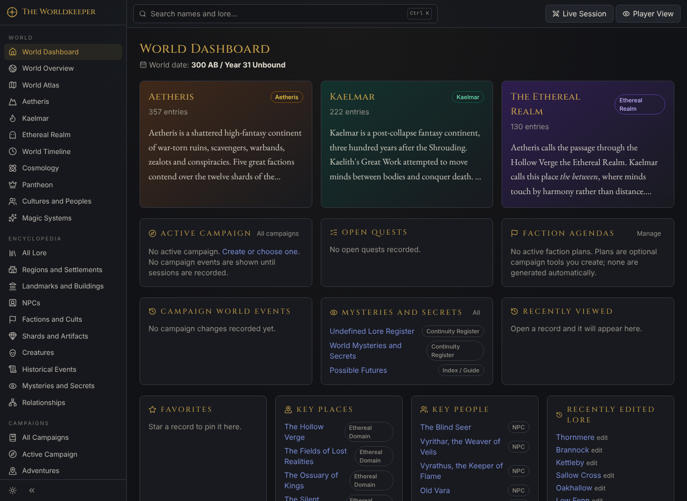
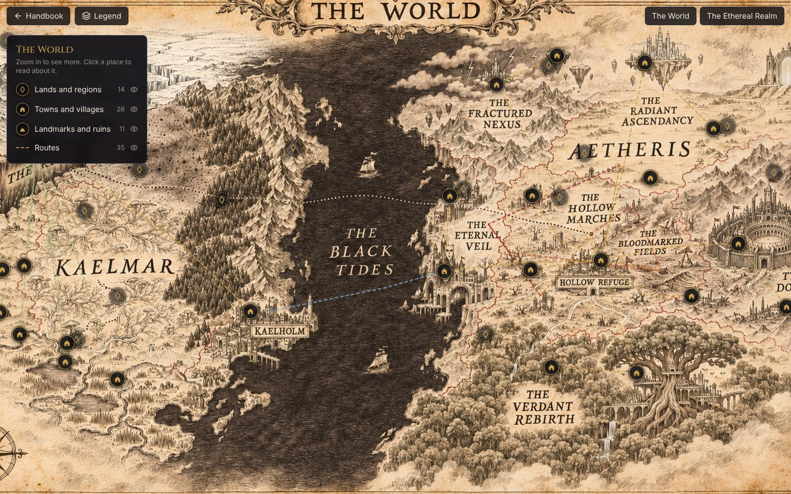
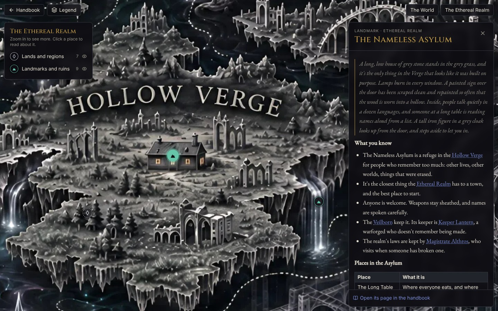
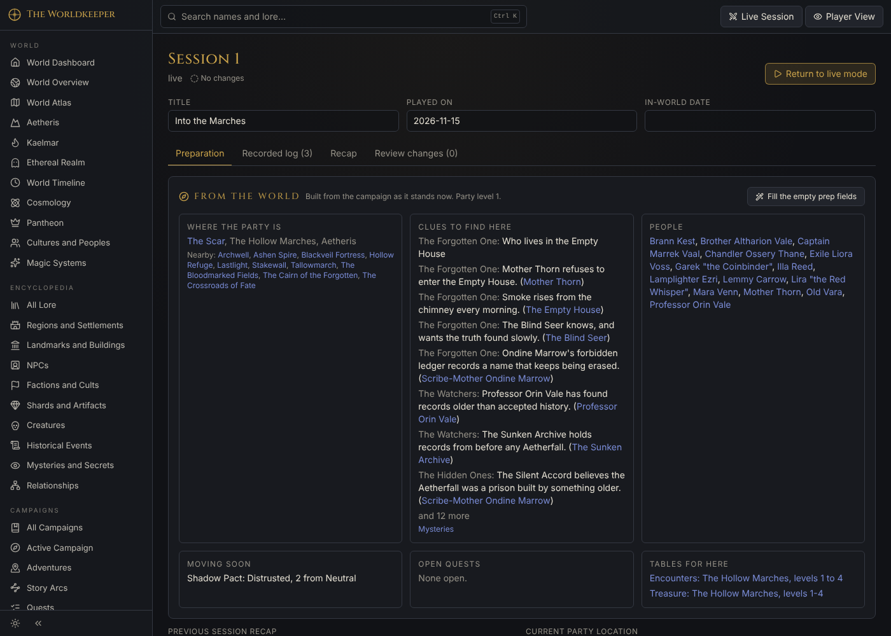

# The Worldkeeper

**Your world. Your canon. Your campaigns.**

The Worldkeeper is a **free, open-source, local-first worldbuilding encyclopedia and D&D 5e (2024) campaign manager**. Import existing Markdown lore, connect characters, factions and locations, explore maps, run sessions, and share only the knowledge your players have discovered.

Originally designed for a world with three branches, **Aetheris**, **Kaelmar**, and the **Ethereal Realm**, it preserves stable IDs, source references, canon labels and GM secrets while providing tools to manage independent campaigns.

**No account, required cloud service, paid API or AI dependency.** World data lives on your computer in SQLite and an uploads directory, with backups and portable exports.

> **Status:** v0.2, early functional release. Some features and desktop platform builds are still undergoing validation. Read [Development Status](DEVELOPMENT_STATUS.md) before relying on the application for important campaign data.

## Screenshots

Actual screenshots from Worldkeeper, showing the application and interactive atlases.

### World dashboard



### World atlas

| World map | Region border editor |
| --- | --- |
|  |  |

The region border editor lets the GM draw and adjust regional boundaries directly on the atlas.

### Ethereal Realm



### Session management



## Why Worldkeeper?

- **Protect established lore.** Preserve original IDs, references and source texts. Record revisions, review canon changes, and keep uncertain facts explicitly `UNDEFINED`.
- **Let campaigns evolve independently.** Track events, changing NPC attitudes, faction influence and locations without silently rewriting world canon.
- **Keep secrets behind the screen.** Player views use a dedicated server-side data projection and explicit reveal controls, rather than hiding GM text in the browser.
- **Run the game in one place.** Manage party sheets, quests, scenes, encounters, initiative, session logs and recaps.
- **Own and move your data.** Use local SQLite storage, Markdown and JSON exports, uploaded map images, and backup archives.
- **Keep AI optional.** Core functionality runs without an external model or service; an optional assistant is a future proposal, not a current requirement.

## Features at a glance

| Area | What it provides |
| --- | --- |
| **Encyclopedia** | Searchable records, Markdown editing, source provenance, record links, revisions and Canon Review |
| **Characters and factions** | Structured profiles, campaign-specific attitudes and goals, regional influence |
| **World exploration** | Maps, hierarchical locations, timelines, relationship graphs, cosmology and realm tools |
| **Campaign management** | Multiple campaigns, party sheets, quests, adventures, scene flows and campaign state overlays |
| **Session tools** | Preparation, live session dashboard, initiative, dice, event log, recaps and player reveals |
| **Player publishing** | Player-only server, static player handbook, optional GitHub Pages publishing |
| **Library operations** | Previewed imports, protective merging, exports, backups and restoration |

See the [complete feature reference](docs/FEATURES.md).

## Get started

### Desktop application

Worldkeeper has a Tauri desktop build path for Linux, macOS and Windows. **Download an installer only for a platform that has a tested release artifact.** See [Releases](https://github.com/n1x-shell/Worldkeeper/releases) and [desktop build notes](docs/DESKTOP.md). If no suitable installer is available, build from source.

### Run from source

Requires **Node.js 20 or later** (22 recommended).

```bash
git clone https://github.com/n1x-shell/Worldkeeper.git
cd Worldkeeper
npm ci
npm run build
npm start
```

Open <http://127.0.0.1:4310>.

For development, run `npm run dev` (API on port 4310, Vite client on port 5173).

For a first-world walkthrough, see [Quick Start](docs/QUICKSTART.md). For the full command list and environment variables, see [Development](docs/DEVELOPMENT.md).

## How it works

```text
Original Markdown library and protected source files
                       |
                       v
             Import preview + review
                       |
                       v
        World encyclopedia + canon history
                       |
            +----------+----------+
            |                     |
            v                     v
     Campaign overlays       Canon Review
            |
            v
      Explicit GM reveals
            |
            v
   Player-safe data projection
            |
        +---+----------------+
        |                    |
   Local/LAN player view   Static player handbook
```

Source facts and campaign developments are intentionally distinct. A fortress captured in one campaign does not become universal canon unless a change is explicitly proposed and approved.

**Player publication is public disclosure.** The player projection is designed to exclude unrevealed material, but you should review the output before sharing it. GitHub Pages sites may be publicly accessible, and material committed to a public repository can remain accessible in its Git history after later removal. See [Player View & Publishing](docs/PLAYER_VIEW.md).

## Data and privacy

By default, Worldkeeper uses `./data/worldkeeper.db`, `./data/uploads/` and `./data/backups/`. The DM web server binds to `127.0.0.1` by default; **do not expose it to an untrusted network**. A separate player-only server is available for LAN use.

Backups are generated on a schedule while the server is running and before sensitive operations. Backups and exports should still be stored and tested independently. Read [Data, Backups & Exports](docs/DATA.md).

## Documentation

| Guide | Contents |
| --- | --- |
| [Quick Start](docs/QUICKSTART.md) | Import a world and prepare the first session |
| [Features](docs/FEATURES.md) | Full encyclopedia, atlas, campaign and table-side feature reference |
| [Player View & Publishing](docs/PLAYER_VIEW.md) | Reveals, player-only LAN server, static handbook, publishing precautions |
| [Data, Backups & Exports](docs/DATA.md) | Import safety, data paths, backup/restore, export formats |
| [Development](docs/DEVELOPMENT.md) | Commands, configuration, keyboard shortcuts and testing |
| [Architecture](docs/ARCHITECTURE.md) | System design, schema and security model |
| [Desktop](docs/DESKTOP.md) | Tauri packaging, prerequisites and platform-specific notes |
| [Development Status](DEVELOPMENT_STATUS.md) | Completed features, known issues and roadmap |

## Development, contributions and security

Stack: **React, TypeScript, Vite, Tailwind CSS, React Flow, Leaflet; Node.js, Express, SQLite (better-sqlite3 / FTS5), zod; Tauri**.

Run `npm test`, `npm run typecheck` and `npm run build` before proposing changes. Testing details are in [Development](docs/DEVELOPMENT.md).

Contributions are welcome subject to review; see [Contributing](CONTRIBUTING.md). To report a security problem, see [Security Policy](SECURITY.md) and avoid publicly disclosing exploitable vulnerabilities before remediation.

## Roadmap

v0.2, **“At the table,”** added record-link suggestions, structured NPC and faction profiles, in-session player reveals, timeline eras and desktop packaging. See [Development Status](DEVELOPMENT_STATUS.md) for feature maturity, known issues and next steps.

An optional, provider-independent AI assistant is planned for a later phase. Any generated lore should enter as a `PROPOSED` draft subject to GM review, not silently become canon.

## License and disclaimer

Licensed under the **BSD 2-Clause License**. See [LICENSE](LICENSE) for the full text.

Worldkeeper is an independent tabletop campaign tool, compatible with fifth edition. It is **not affiliated with or endorsed by Wizards of the Coast**. Apart from the System Reference Document 5.2.1 rules used by the character sheet and builder (spells, class tables and features, species traits, feats, backgrounds, weapons and armor), it does not bundle official D&D rulebook text or monster stat blocks; users provide their own appropriately licensed or owned material.

This work includes material from the System Reference Document 5.2.1 (“SRD 5.2.1”) by Wizards of the Coast LLC, available at https://www.dndbeyond.com/srd. The SRD 5.2.1 is licensed under the Creative Commons Attribution 4.0 International License, available at https://creativecommons.org/licenses/by/4.0/legalcode.

> “The Worldkeeper” is a working title. You can rename your installation under **Settings**.
